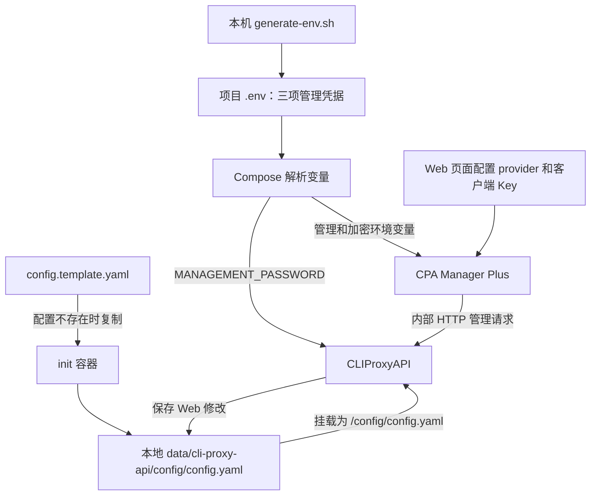

# CPA Manager Plus 全新环境部署

使用 Docker Compose 统一运行 CPA Manager Plus 和 CLIProxyAPI，面向全新环境部署。镜像固定为：

- `seakee/cpa-manager-plus:1.12.10`
- `eceasy/cli-proxy-api:v7.2.156`

相关项目及详细功能说明：

- [CLIProxyAPI](https://github.com/router-for-me/CLIProxyAPI)：提供模型代理 API 和管理接口。
- [CPA Manager Plus](https://github.com/seakee/CPA-Manager-Plus)：提供 Web 管理页面。

本仓库提供上述项目的 Compose 部署配置；应用本身的使用说明请参阅各自的上游仓库。

## 部署前准备

克隆本仓库并进入项目根目录。运行下面的命令前，需要满足：

- Docker 已安装且正在运行，`docker compose version` 能正常执行。
- 本机有 Bash，以及 `od`、`head`、`base64`、`tr` 等标准命令，用于生成随机密钥。
- `compose.yaml` 中发布的端口可用，其中 `18317` 为 Manager 页面端口，`8317` 为 CLIProxyAPI 端口。

仓库提供完整的部署入口：

```text
compose.yaml          # 服务、启动依赖、端口和数据目录挂载
generate-env.sh       # 本机生成管理凭据，不启动服务
.env.example          # 手动配置环境变量的示例
config.template.yaml  # 首次启动的默认 CLIProxyAPI 配置
scripts/init.sh       # 容器内准备目录和首次复制配置
```

新克隆的项目不包含 `.env`、`data/` 或实际 `config.yaml`，这些文件和目录会自动创建，无需从其他环境复制。

## 首次启动与 Web 配置

在项目根目录执行：

```bash
./generate-env.sh
docker compose up -d --wait --wait-timeout 120
```

`generate-env.sh` 仅在本机生成权限为 `600` 的 `.env`，不调用 Docker，不覆盖已有 `.env`。文件只保存 Manager 管理员密钥、CLIProxyAPI 管理密钥和 Manager 数据加密密钥。provider 和客户端 API Key 不在 `.env` 中配置。

首次启动时，init 创建本地数据目录，并将仓库模板复制为 `data/cli-proxy-api/config/config.yaml`。CLIProxyAPI 启动并通过健康检查后，Manager 再启动。无需预先准备运行配置或数据目录。

可检查启动结果：

```bash
docker compose ps -a
```

两个业务服务应显示为 `healthy`。init 完成后显示 `Exited (0)`，这是正常状态；它负责准备配置，不是需要长期运行的服务。全新环境的 provider、客户端 API Key 和请求记录均为空，尚不能向上游模型发起有效调用。

打开 <http://localhost:18317/management.html>，使用 `.env` 中的 `CPA_MANAGER_ADMIN_KEY` 登录。Manager 已通过部署配置连接 `http://cli-proxy-api:8317`，无需手动填写 CPA 连接。接着在 Web 页面完成业务配置：

1. 在「配置面板 → 认证配置」添加客户端 API Key；该操作会立即保存。
2. 在「AI 提供商」添加 provider，或通过「OAuth 登录」连接账号。
3. 客户端携带所添加的 API Key，访问 `http://localhost:8317/v1`。

首次配置没有 provider 和客户端 Key；先添加客户端 Key，再启用 provider，确保业务 API 有客户端鉴权。

CLIProxyAPI 的独立管理页面为 <http://localhost:8317/management.html>，使用 `.env` 中的 `CPA_MANAGEMENT_KEY` 登录。此页面由 CLIProxyAPI 联网下载并缓存；CPA Manager Plus 的页面内置于其镜像，不依赖这次下载。

| 入口 | 用途 | 使用的密钥 |
| --- | --- | --- |
| `http://localhost:18317/management.html` | Manager 页面：配置客户端 Key、provider、OAuth 和查看用量 | `.env` 中的 `CPA_MANAGER_ADMIN_KEY` |
| `http://localhost:8317/management.html` | CLIProxyAPI 独立管理页面 | `.env` 中的 `CPA_MANAGEMENT_KEY` |
| `http://localhost:8317/v1` | 客户端模型 API | 在 Web 页面添加的客户端 API Key |

## 环境变量

默认由 `generate-env.sh` 自动生成以下三项。若要自己指定管理凭据，可复制 `.env.example` 为 `.env` 后手动填写；脚本不会补全已有文件：

| 变量 | 用途 |
| --- | --- |
| `CPA_MANAGER_ADMIN_KEY` | Manager 初始管理员登录密钥；修改变量不会重置已有管理员凭据 |
| `CPA_MANAGEMENT_KEY` | CLIProxyAPI 管理密码，同时供 Manager 调用其管理接口 |
| `CPA_MANAGER_DATA_KEY` | Manager 数据库敏感配置的加密密钥，格式为 32 字节随机值的 Base64 编码；已有数据时不要更换 |

可选的 `DATA_ROOT`、`CLI_PROXY_IMAGE`、`CPA_MANAGER_IMAGE` 和 `DEPLOY` 已有默认值，无需在 `.env` 中重复定义。`DATA_ROOT` 默认 `./data`，相对路径按 Compose 项目目录解析。

`TZ`、`HTTP_ADDR`、`USAGE_DATA_DIR`、`USAGE_DB_PATH`、`CPA_MANAGER_DATA_KEY_PATH` 和 `CPA_UPSTREAM_URL` 直接在 Compose 中设置，每项都有用途注释。单独在 `.env` 中添加这些同名变量不会覆盖固定值。

`.env`、`data/` 和本地验证产物均被 Git 忽略。部署文件、模板、脚本和 `.env.example` 可以提交，真实配置和密钥保存在本地。

## 服务配合和配置流转



- Compose 读取 `.env`，替换 YAML 中的 `${变量}`，再将各服务 `environment` 声明的项传入容器。`.env` 不会整份自动传给容器；shell 中已导出的同名变量优先于 `.env`。
- init 只准备目录和首次复制模板，不读取 `.env`，不替换 provider 或客户端 Key。
- CLIProxyAPI 读取 `/config/config.yaml`；Compose 将 `CPA_MANAGEMENT_KEY` 映射为其原生环境变量 `MANAGEMENT_PASSWORD`，所以模板的 `remote-management.secret-key` 留空。
- Manager 从环境变量取得初始登录、加密和 CPA 连接配置，通过服务名 `cli-proxy-api` 调用管理接口。它不直接读取 CLIProxyAPI 的配置文件。
- Web 页面保存的 provider、客户端 Key 和其他 CLI 设置写入持久化的 `config.yaml`。Manager 自己的配置和 Key 别名等信息保存在其数据库中，OAuth 认证文件保存在独立认证目录。

变量替换和依赖等待规则见 Docker 的[变量插值文档](https://docs.docker.com/compose/how-tos/environment-variables/variable-interpolation/)和[启动顺序文档](https://docs.docker.com/compose/how-tos/startup-order/)。

## 修改配置与重复启动

日常直接通过 Web 页面管理 provider 和客户端 Key，无需编辑 `.env` 或重新执行密钥生成脚本。也可以在「配置面板 → 源文件编辑」修改运行配置；这些修改同样会持久化。

不同配置的操作方式如下：

| 要修改的内容 | 操作位置 | 应用方式 |
| --- | --- | --- |
| provider、客户端 Key、CLI 运行设置 | Web 页面 | 保存后写入持久化配置，init 后续不会覆盖 |
| OAuth 账号 | Web 的 OAuth 登录入口 | 认证文件写入持久化的 `auths/` 目录 |
| 部署管理密码、镜像版本、数据根目录 | `.env` | 修改后执行 `docker compose up -d --wait --wait-timeout 120`；管理员凭据和数据加密密钥仍遵循前述限制 |

init 不是只执行一次的容器：对整个项目再次 `up`、`start` 或 `restart` 时，已退出的 init 可能再次执行。但只要 `config.yaml` 已存在且非空，脚本就保留它；不会覆盖 Web 页面配置，不删除数据库或认证文件。已有配置为空、目录或失效链接时会报错，需要检查文件路径。

`restart: "no"` 只禁止 Docker 自动重启 init。业务服务自动恢复时不会重新运行它。全项目 `restart` 不保证像 `up` 一样等待初始化和健康检查；日常仅需重启两个业务服务时使用：

```bash
docker compose restart cli-proxy-api cpa-manager-plus
```

修改部署环境变量后使用以下命令，使 Compose 重建配置发生变化的容器：

```bash
docker compose up -d --wait --wait-timeout 120
```

`restart`、`start` 不应用修改后的容器环境变量。[Docker restart 文档](https://docs.docker.com/reference/cli/docker/compose/restart/)

`config.template.yaml` 只影响尚未创建配置的新部署。修改模板不会自动更新已有 `config.yaml`；已有部署的运行设置应通过 Web 页面修改。

## 数据位置

使用服务内的简写 bind 挂载，不定义顶层命名 volumes：

| 本地目录 | 容器目录及用途 |
| --- | --- |
| `data/cpa-manager-plus/` | Manager `/data`，保存 SQLite 数据库等文件 |
| `data/cli-proxy-api/config/` | CLIProxyAPI `/config`，保存 `config.yaml`、`logs/` 和 `static/` |
| `data/cli-proxy-api/auths/` | CLIProxyAPI `/root/.cli-proxy-api`，保存 OAuth 认证文件 |

无需单独挂载 `/config/static`，它包含在整个 `/config` 的持久化挂载中。CLIProxyAPI 页面缓存位于 `data/cli-proxy-api/config/static/management.html`。

`docker compose down` 删除容器和网络，保留本地数据。保全部署时需要同时保存 `.env` 和 `data/`，尤其是数据加密密钥。

## 日常管理

```bash
docker compose ps -a
docker compose logs --tail 100 -f cli-proxy-api cpa-manager-plus
docker compose stop
docker compose up -d --wait --wait-timeout 120
```

升级时先在 `.env` 中设置明确的新镜像版本，然后执行 `docker compose pull` 和上述 `up` 命令。当前固定版本不会自动跟随上游版本。

## 许可证

本仓库的部署配置与脚本采用 [MIT License](LICENSE)；上游应用的许可证请以各自仓库为准。
